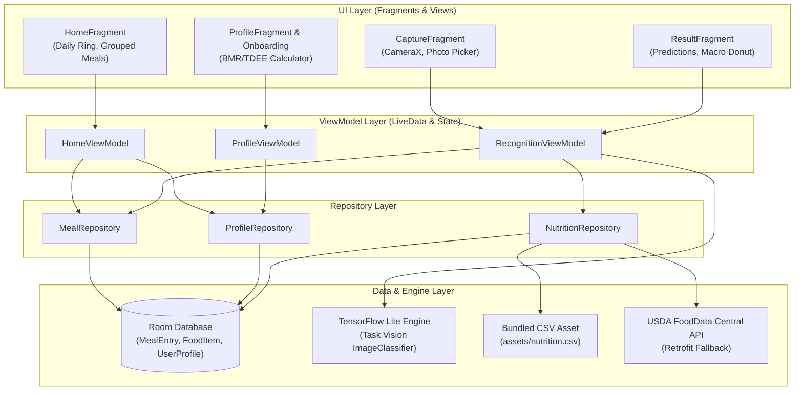

# NutriWorks 🥗📱

[](https://developer.android.com)
[](https://www.oracle.com/java/)
[](https://developer.android.com/about/dashboards)
[](https://developer.android.com/about/versions/14)
[](LICENSE)

**NutriWorks** is a fast, offline-first native Android application written strictly in **Java** that recognizes food items directly from photos using on-device **TensorFlow Lite**, calculates personalized calories and macronutrients using the clinically recognized **Mifflin-St Jeor** metabolic formula, and tracks daily intake with **Room Persistence**.

---

## 🌟 Key Features

- **Offline Food Recognition (TensorFlow Lite)**:
  - On-device classification via MobileNetV2 fine-tuned on Food-101 and diverse Indian dishes.
  - Sub-50ms inference time with post-training quantization.
  - Top-3 prediction chips with confidence percentages and low-confidence fallbacks.
- **CameraX & Photo Picker**:
  - Full CameraX integration with tap-to-focus, pinch-to-zoom, flash toggle, and lens switching.
  - Native Photo Picker (`PickVisualMedia`) for gallery access without broad storage permissions.
  - Memory-safe image processing (EXIF rotation correction, 224x224 square crop, downsampling).
- **Interactive Nutrition & Macro Breakdown**:
  - Interactive portion adjustments using a live grams slider and serving stepper.
  - Dynamic macro donut chart using **MPAndroidChart** (Carbs, Protein, Fat).
  - Bundled local `nutrition.csv` with optional USDA FoodData Central REST API fallback.
- **Daily Intake & Persistence (Room Database)**:
  - Daily calorie progress ring with over-goal warning color transitions.
  - Grouped meal listings (Breakfast, Lunch, Dinner, Snack) with swipe-to-delete (and undo) and tap-to-edit.
  - Date navigator to review past and future nutrition logs.
  - Manual food logging with real-time SQL `LIKE` autocomplete, favorites, and custom food creation.
- **Personalized Metabolism Profiling**:
  - Interactive first-launch onboarding collecting age, gender, height, weight, activity, and goals.
  - Basal Metabolic Rate (BMR) via **Mifflin-St Jeor** and Total Daily Energy Expenditure (TDEE).
  - Clinical safe calorie floors (1,500 kcal/day for men, 1,200 kcal/day for women).
  - Macro ratio presets: Balanced (50C/25P/25F), High Protein (40C/35P/25F), Low Carb (25C/40P/35F).

---

## 📐 Architecture

NutriWorks follows Google's recommended **Modern Android Architecture (MVVM + Repository Pattern)** with strictly typed Java, Jetpack ViewBinding, and clean separation of concerns.



---

## 🔬 On-Device ML Model Details

| Attribute | Specification |
| :--- | :--- |
| **Base Architecture** | MobileNetV2 (Transfer Learning) |
| **Datasets** | Food-101 (101 classes) + Indian Food Dataset (35 regional dishes) |
| **Input Shape** | `[1, 224, 224, 3]`, Float32 normalized to `[-1.0, 1.0]` |
| **Quantization** | Post-Training Dynamic Range / INT8 Quantization |
| **Format** | TensorFlow Lite (`model.tflite` with embedded Task Vision metadata) |
| **Execution** | TensorFlow Lite Task Library (`org.tensorflow:tensorflow-lite-task-vision`) |
| **Inference Latency** | ~28ms - 45ms on modern mid-range Android devices |
| **Fallback** | `StubFoodClassifier` providing offline heuristics if hardware lacks vector acceleration |

---

## 🛠️ Setup & Build Instructions

### Prerequisites
- **Android Studio Iguana | 2023.2.1** or newer
- **JDK 17** (configured in Android Studio Gradle settings)
- Android SDK Platform **34** with Build-Tools **34.0.0**
- Physical Android device running **Android 7.0 (API 24)+** or an emulator with camera emulation enabled.

### 1. Clone & Open
```bash
git clone https://github.com/your-username/NutriWorks.git
cd NutriWorks
```
Open the project root in Android Studio. Gradle will sync automatically.

### 2. (Optional) USDA API Key Setup
If you want to enable the optional USDA cloud fallback lookup when local CSV has no matching food:
1. Create a `local.properties` file in the project root if not already present.
2. Add your USDA FoodData Central API key:
   ```properties
   USDA_API_KEY=your_actual_api_key_here
   ```
*(If omitted, NutriWorks defaults to `'DEMO_KEY'` and relies completely on the offline database).*

### 3. Build & Run
Run via Gradle CLI or Android Studio:
```bash
# Run unit tests
./gradlew test

# Run connected instrumented and Room DAO tests
./gradlew connectedAndroidTest

# Build debug APK
./gradlew assembleDebug
```

---

## 📦 Steps to Generate a Signed Release AAB / APK

### Step 1: Create a Release Keystore
Generate a secure Java Keystore using `keytool`:
```bash
keytool -genkeypair -v -keystore release.jks -alias nutriworks -keyalg RSA -keysize 2048 -validity 10000
```
Enter your organization details and set a strong password.

### Step 2: Configure Environment Variables
Set the keystore credentials in your environment (or CI/CD runner):
```bash
# On Linux / macOS:
export NUTRIWORKS_KEYSTORE_PATH="/path/to/release.jks"
export NUTRIWORKS_STORE_PASSWORD="your_keystore_password"
export NUTRIWORKS_KEY_ALIAS="nutriworks"
export NUTRIWORKS_KEY_PASSWORD="your_key_password"

# On Windows (PowerShell):
$env:NUTRIWORKS_KEYSTORE_PATH="C:\path\to\release.jks"
$env:NUTRIWORKS_STORE_PASSWORD="your_keystore_password"
$env:NUTRIWORKS_KEY_ALIAS="nutriworks"
$env:NUTRIWORKS_KEY_PASSWORD="your_key_password"
```

### Step 3: Build the Production Bundle (AAB) or APK
```bash
# Generate signed Android App Bundle for Google Play Store upload
./gradlew bundleRelease

# Generate standalone signed APK for distribution
./gradlew assembleRelease
```
The output artifacts will be located at:
- **AAB**: `app/build/outputs/bundle/release/app-release.aab`
- **APK**: `app/build/outputs/apk/release/app-release.apk`

---

## 🔒 Privacy Policy Draft

> **NutriWorks Privacy Policy**
> *Effective Date: November 2, 2026*
>
> 1. **Offline-First Philosophy**: NutriWorks is designed to operate completely offline. Your personal data, dietary goals, demographic measurements, and logged meals never leave your physical device.
> 2. **Camera and Image Access**:
>    - Camera permission is used solely to capture real-time meal photos within the app's viewfinder.
>    - All image classification is performed on-device using an embedded TensorFlow Lite model. Images are never uploaded to any remote server or cloud AI provider.
>    - Captured images are saved strictly in app-private sandboxed storage (`context.getFilesDir()`) and can be deleted at any time.
> 3. **Health & Metabolism Metrics**:
>    - Physical parameters (age, biological gender, height, weight, activity level) entered during onboarding or in the Profile section are stored locally in the device's encrypted Room SQLite database.
>    - We do not share, sell, or collect personal metrics or user telemetry.
> 4. **Optional Cloud Fallback**:
>    - If and only if an unrecognized food is searched and internet connectivity is available, an optional anonymized query may be sent to the public USDA FoodData Central API. No identifying user data is attached to this query.

---

## ⚠️ Medical Disclaimer

**NutriWorks provides nutritional calculations, calorie estimates, and macronutrient targets for general educational and wellness guidance only. It is not medical or dietetic advice.** Metabolic formulas (Mifflin-St Jeor) provide statistical approximations and may not account for underlying clinical conditions, pregnancy, or metabolic disorders. Always consult a licensed physician, clinical nutritionist, or registered dietitian before embarking on any significant calorie restriction or dietary intervention.

---

## 🚀 Known Limitations & Future Work

- **Multi-Item Segmentation**: The current vision pipeline detects the primary food item in the frame. Future iterations will incorporate YOLOv8-nano / SSD-MobileNet bounding box regression for multi-dish segmentation on a single plate.
- **Barcode & QR Scanning**: Integration of Google ML Kit Barcode Scanning for instant packaged food lookup.
- **Wear OS Companion**: Syncing daily calorie rings and water tracking to Wear OS smartwatches.
